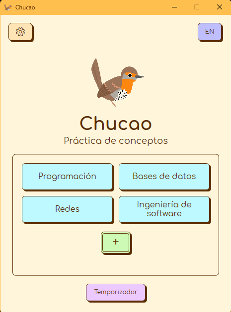

# Chucao: Práctica de conceptos

Aplicación de escritorio para Windows para practicar la explicación oral de conceptos mediante selección aleatoria sin repetición por ronda.

**English overview:** Chucao is a Windows desktop application for practicing spoken explanations of randomly selected concepts, without repetition within each round. It includes concept lists, an animated practice timer, configurable sound, Spanish and English interfaces, and local CSV storage.



## Funcionalidades

- Creación y eliminación de listas; adición individual o por conjuntos de conceptos.
- Selección aleatoria, marcado como visto y reinicio de rondas.
- Temporizador de 1 a 59 minutos con pausa, animación del ave y sonido configurable.
- Interfaz en español e inglés, con cambio de idioma durante el uso.
- Listas, progreso y preferencias guardados localmente en CSV.

Para practicar, se crea una lista, se añaden conceptos y se selecciona uno al azar. La explicación puede acompañarse con el temporizador. Cuando se agotan los conceptos, se reinicia la lista desde la interfaz para comenzar otra ronda.

## Descargar y ejecutar

Los ejecutables se distribuyen mediante [GitHub Releases](https://github.com/sebastianolmos/chucao/releases).

Se descarga el paquete para Windows, se extrae el ZIP completo y se abre `Chucao.exe`. Se conservan los archivos y carpetas que lo acompañan, incluido el audio. Las versiones **autocontenidas** incluyen .NET y no requieren instalarlo por separado.

## Desarrollo

Se desarrolló con **C#, .NET 10, WPF y CsvHelper**. Para compilar desde el código fuente se requieren Windows y el SDK de .NET 10. Los siguientes comandos se ejecutan desde la raíz del repositorio:

```powershell
dotnet build .\src\Chucao\Chucao.csproj
dotnet run --project .\src\Chucao\Chucao.csproj
```

Para ejecutar las comprobaciones de lógica y persistencia:

```powershell
dotnet run --project .\tests\Chucao.Checks\Chucao.Checks.csproj
```

## Documentación

- [Personalización visual, imágenes y animación](docs/customization.md).
- [Formato de datos, preferencias y respaldos](docs/data-format.md).

## Créditos y licencias

El proyecto fue creado y desarrollado por **Sebastian Olmos**. El código se distribuye bajo la [licencia MIT](LICENSE), con las excepciones indicadas a continuación.

**Tipografía:** Comfortaa © 2011 The Comfortaa Project Authors, bajo la [SIL Open Font License 1.1](Assets/Fonts/OFL.txt).

Sonido del chucao: Gabriel Morales — [XC870902, xeno-canto](https://xeno-canto.org/870902), bajo [CC BY-NC-SA 4.0](https://creativecommons.org/licenses/by-nc-sa/4.0/).

Modificaciones: reducción de ruido y recorte de fragmentos.

El audio editado y la secuencia audiovisual del temporizador se distribuyen bajo CC BY-NC-SA 4.0 y quedan excluidos de la licencia MIT.
